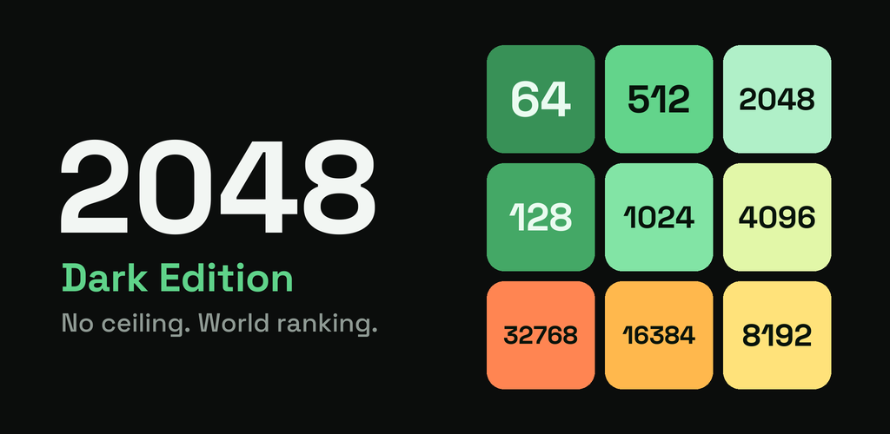

# 2048 Dark Edition

An endless sliding-tile game for Android with a verified world ranking. Kotlin, Jetpack Compose, 2 MB.



- **No ceiling.** Tiles keep going past 2048, past 131072, into the millions on 5×5.
- **Four modes.** Classic 4×4, Grand 5×5, Blitz (3 minutes), Zen (unlimited undo, unranked).
- **18 ranks**, Pebble to Infinite, plus levels, 74 achievements and daily goals.
- **World ranking by flag**: worldwide, your country, this week, nations. Every score is replayed and verified by the server.
- **Smooth.** One canvas, one frame loop, no recomposition while tiles move. Swipes fire before the finger lifts and are never queued or dropped.
- Dark and light themes, five palettes, sound, haptics, landscape and tablet layouts, PDF stats report.

## Build

Needs JDK 17+ and Android SDK 36.

```bash
gradlew.bat testDebugUnitTest      # rules, replay vectors, ranks, goals
gradlew.bat assembleDebug          # debug APK
gradlew.bat bundleRelease          # AAB for Play
```

Release signing reads a git-ignored `keystore.properties` (`storeFile`, `storePassword`, `keyAlias`, `keyPassword`). Without it the release build is unsigned.

The ranking needs the server in [`server/`](server/README.md) and its URL in `gradle.properties`. Without it the app runs fully offline.

## Layout

| Path | What |
|---|---|
| `app/.../game` | Engine, modes, ranks, achievements, goals, view model (no UI) |
| `app/.../data` | Models, atomic JSON storage, v1 import |
| `app/.../net` | Ranking client with offline queue |
| `app/.../ui/board` | Tile animator, canvas board, swipe detection |
| `app/.../screens` | Every screen |
| `server/` | Cloudflare Worker + D1 ranking API |
| `store/` | Play listing text and graphics |

Start with [CONTEXT.md](CONTEXT.md). Launch checklist: [PLAYSTORE_STEPS.md](PLAYSTORE_STEPS.md). `README_2048_APK.md` is the original v1 spec, kept for history. [Privacy policy](PRIVACY.md). Space Grotesk is used under the SIL Open Font License.
